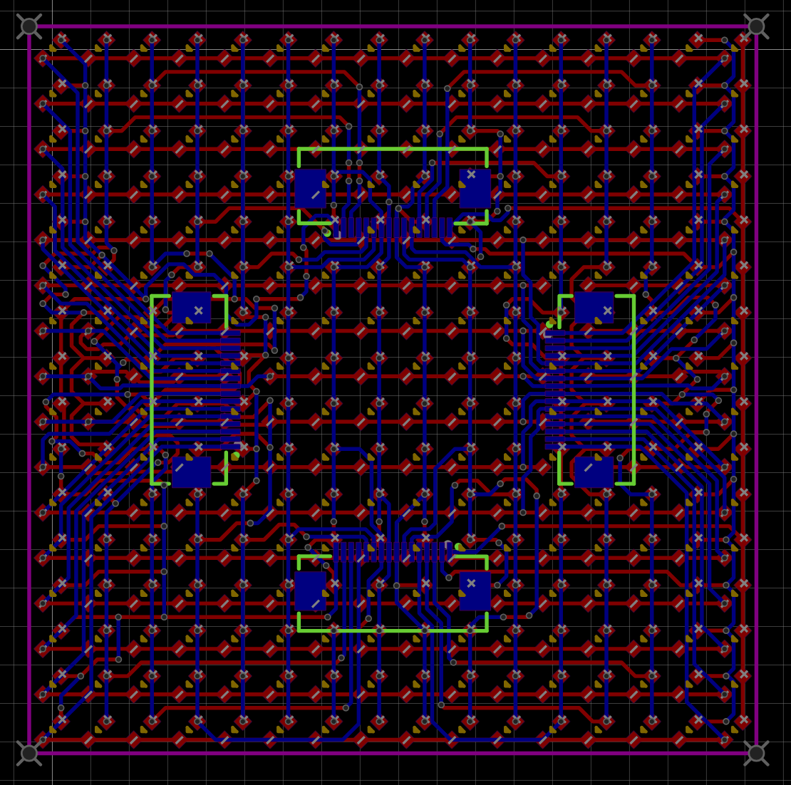
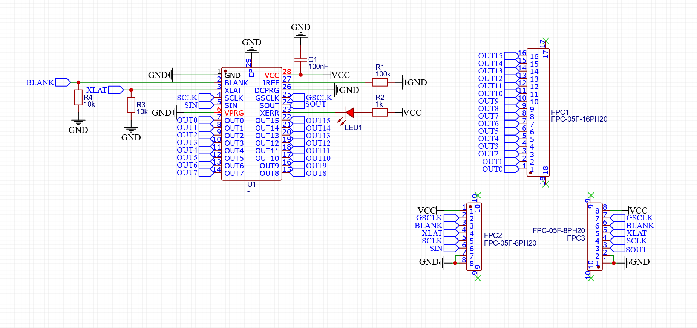
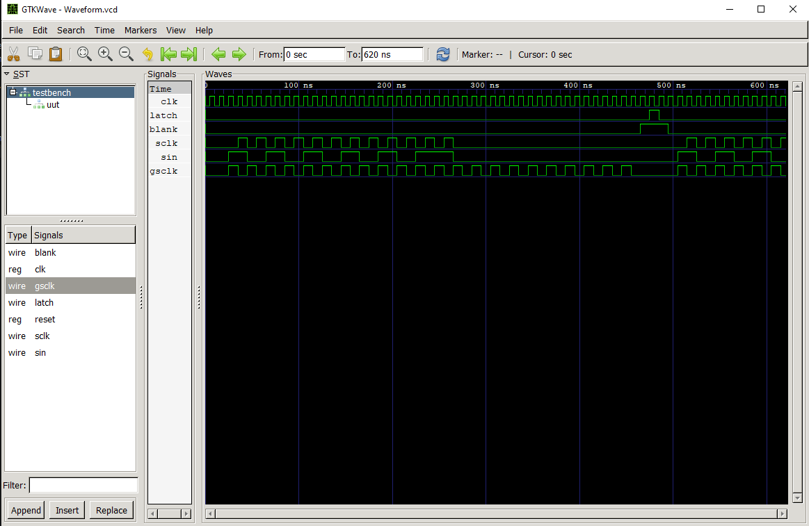
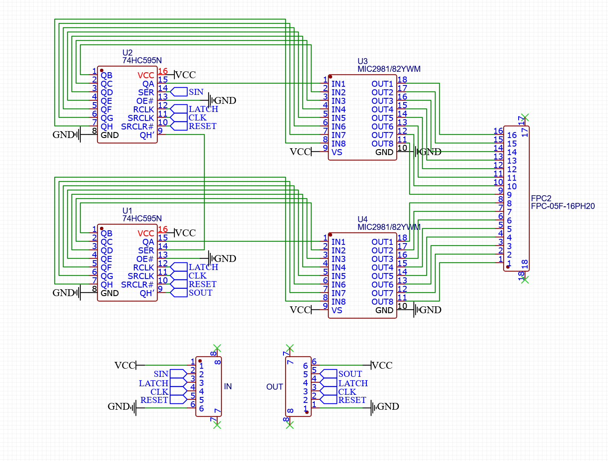
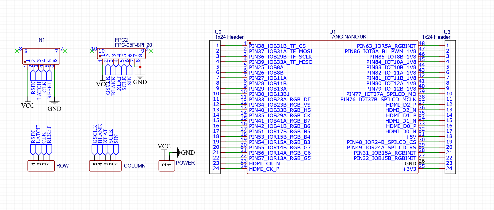

# FPGA-Controlled LED Wall Art

This project involved designing and building a modular LED wall display using monochromatic red LEDs with individual brightness control.

The display uses FPGA-based control, multiplexing, and grayscale PWM to create a customizable wall-art display. The system was designed as a modular platform, allowing the overall display size to be easily expanded or modified by connecting additional LED matrix panels.

## Project Requirements

- Monochromatic red LED display
- Individual LED brightness control
- FPGA-based control
- Row and column multiplexing
- Grayscale brightness control
- Modular and expandable display structure
- High refresh rate

<br>

# Project Design

The project was divided into four separate PCBs:

- LED Matrix
- Column Controller
- Row Controller
- FPGA Expansion Board

This modular approach allowed each part of the system to be developed and tested independently while also making it possible to scale the final display.

<br>

# LED Matrix

The LED matrix board consists of a 16×16 array of red LEDs with FPC connectors for the row and column signals.

The FPC connectors were designed to create a chaining system, allowing multiple LED matrix boards to be connected together both horizontally and vertically.

This makes the overall display size highly configurable while also simplifying maintenance. Individual panels can be removed or replaced without having to redesign or rebuild the entire display.



Designing the matrix PCB was one of the more challenging parts of the project due to the large number of traces that needed to be routed while keeping the board compact.

This provided a valuable opportunity to improve my PCB routing skills and work with high-density signal routing.

<br>

# Column Controller

The column controller is responsible for sinking the current for the LED columns and controlling their individual brightness.

The main component on this board is the **TLC5940PWP**, a 16-channel, 12-bit grayscale constant-current sink.

Each of the 16 channels can be assigned a grayscale value between **0 and 4095**, allowing each LED column to be controlled with 12-bit brightness resolution.



## TLC5940 Grayscale Control

The TLC5940 uses a combination of shift registers and a grayscale counter to control LED brightness.

The basic operation consists of the following steps:

### 1. Shift in the Data

The grayscale values for all 16 channels are shifted into the internal shift register.

Each channel requires a 12-bit value, resulting in:

```text
16 channels × 12 bits = 192 bits
```

The data is transferred using the **SIN** and **SCLK** signals.

### 2. Latch the Data

Once all channel values have been shifted into the device, the data needs to be transferred into the grayscale control registers.

This is performed using the **XLAT** and **BLANK** signals.

### 3. Generate the Grayscale Clock

The **GSCLK** signal drives the internal grayscale counter.

Each GSCLK pulse increments the counter. The TLC5940 continuously compares the grayscale counter against the value stored for each channel.

If the counter exceeds a channel's stored grayscale value, that channel is switched off for the remainder of the grayscale cycle.

Repeating this process at a sufficiently high frequency causes the human eye to perceive the LED as being dimmed.

### 4. Restart the Cycle

The grayscale counter operates from `0` to `4095`.

Once the counter reaches its maximum value, the cycle starts again.



<br>

## FPGA Optimization

The basic TLC5940 control sequence can introduce periods where the display must be blanked while new data is being transferred.

To maximize the display refresh rate, I optimized the FPGA implementation so that data shifting occurs while the grayscale cycle is already in progress.

The **GSCLK** signal is generated on the positive edge of the FPGA clock, effectively dividing the FPGA clock frequency by two.

Instead of stopping the grayscale clock and blanking the display while new data is shifted in, the GSCLK continues running during the data transfer.

The next set of grayscale data is shifted into the TLC5940 while the current data is still being displayed. The data is then latched at the appropriate point in the cycle.

This overlapping of data transfer and display operation reduces unnecessary downtime and improves the effective refresh rate of the display.

The simulation shown above uses a reduced data width for simplicity, but the same principle is applied to the full 192-bit TLC5940 data frame.

<br>

# Row Controller

The row controller is responsible for selecting which row of the LED matrix is currently active.

The circuit consists of:

- Two **74HC595N** 8-bit shift registers
- One **MIC2981** high-current source driver

The two 74HC595 shift registers provide the required number of control signals for the matrix.

To perform row multiplexing, a single active bit is continuously shifted through the registers. This creates a moving selection signal that activates one row at a time.



By switching between rows rapidly enough, the entire display appears to be illuminated simultaneously due to the persistence of human vision.

<br>

# FPGA Expansion Board

The FPGA expansion board provides a simple interface between the FPGA development board and the rest of the project.



The primary purpose of this board was to provide easy access to the FPGA's available I/O pins during development.

Having the pins exposed made it possible to experiment with different FPGA pin assignments and determine which configuration worked best for the LED matrix, row controller, and column controller.

This also made the board useful during prototyping and debugging before finalizing the FPGA pin configuration.

<br>

# Finished Prototype


The completed prototype demonstrated a modular FPGA-controlled LED display with individually adjustable LED brightness.

The project successfully combined:

- FPGA-based digital logic
- LED matrix multiplexing
- 12-bit grayscale brightness control
- Constant-current LED driving
- Shift-register-based row selection
- High-speed serial data transfer
- Custom PCB design
- Modular PCB architecture

The project was particularly valuable as an exercise in FPGA timing optimization. Overlapping grayscale data transmission with the active display cycle allowed the system to make better use of the available processing and communication time while maintaining a high display refresh rate.

Overall, this project provided practical experience in FPGA development, digital communication protocols, LED driving, PCB design, timing optimization, and designing modular hardware systems.