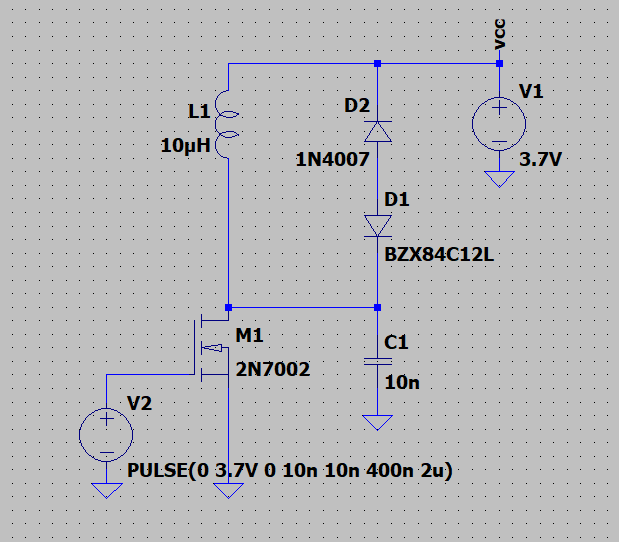
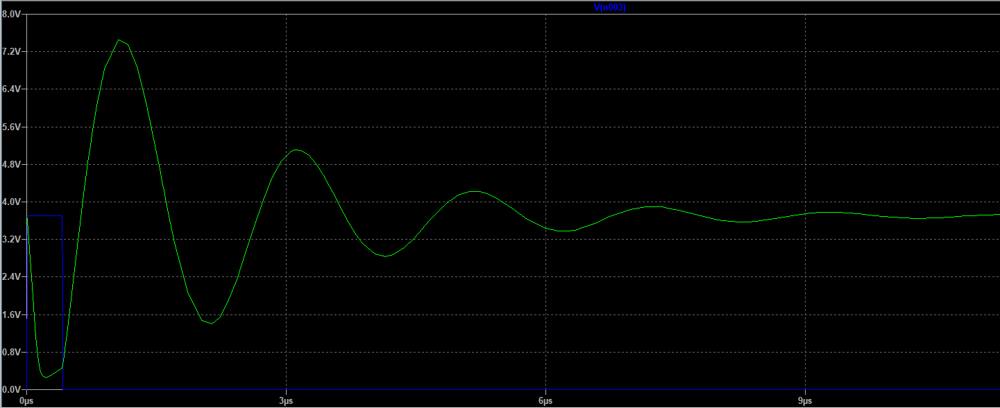
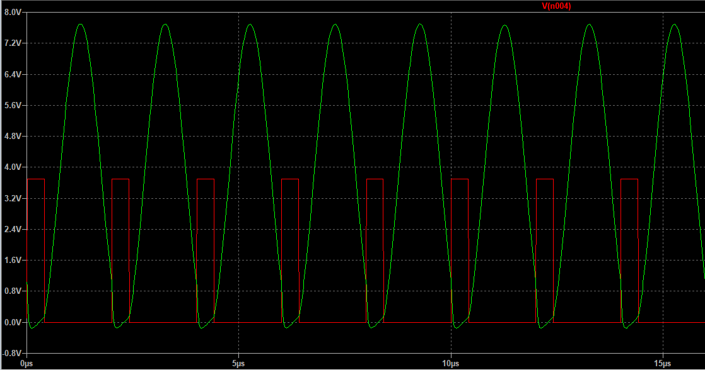
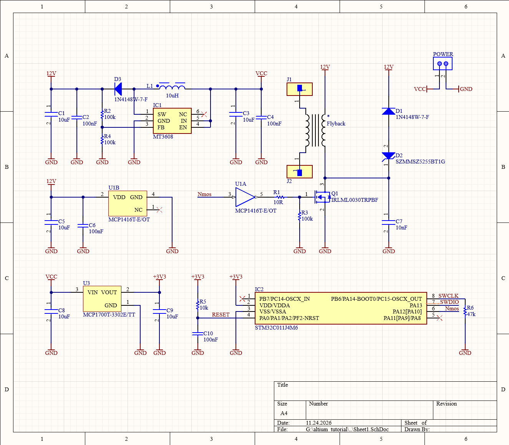
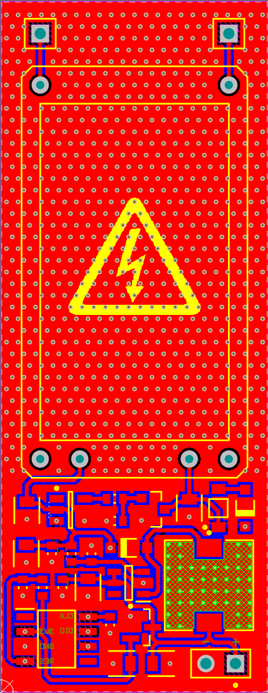
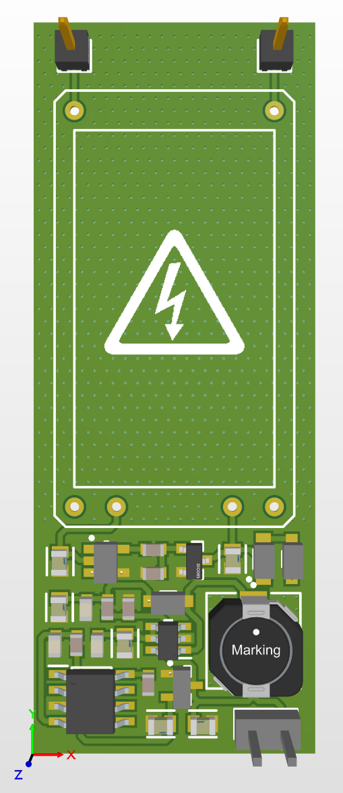

# High Voltage Source for Gen 1 Night Vision Tube

Recently, I acquired an old Gen 1 night vision tube manufactured in Russia. To operate, the tube requires a high voltage supply capable of accelerating electrons through the internal amplification stages, eventually producing a visible image on the phosphor screen.

The goal of this project is to design a compact, battery-powered high voltage source capable of generating approximately 19 kV DC, suitable for powering the night vision tube.

## The Idea and Simulations

The initial concept is based on a resonant flyback-style converter using a high-turn-ratio transformer to generate the required high voltage.

The circuit operates by periodically switching an NMOS transistor, controlling the current flowing through the primary winding of the transformer. When the transistor turns on, current begins flowing through the primary winding, storing energy in the magnetic field. When the transistor turns off, the magnetic field collapses, inducing a high voltage across the transformer windings.

A Zener diode is used to limit the voltage across the MOSFET, protecting it from excessive voltage spikes. An additional diode is incorporated into the circuit to prevent an unintended current path through the clamping network, which could otherwise bypass the primary winding.

The capacitor connected to the transformer forms a resonant circuit, influencing the oscillation frequency and the resulting voltage waveform. Its value plays an important role in determining the resonant characteristics of the circuit.

The resulting oscillatory waveform is illustrated below:

### Switching Optimization

The PWM duty cycle controlling the MOSFET must be adjusted to achieve the desired voltage waveform while keeping the MOSFET within its operating limits.

To minimize switching losses, the switching frequency should also be tuned to ensure that the MOSFET turns on when the voltage across its drain-source terminals is as close to zero as possible. This approach reduces the energy dissipated during switching, particularly the energy associated with charging and discharging the drain-source capacitance.

The effect of adjusting the switching frequency can be observed in the following simulation:

## Schematic Design

After completing the simulations, the circuit schematic was designed in Altium Designer.

Several improvements were introduced compared to the original LTspice simulation:

- **Gate Driver:** The MCP1416T gate driver was introduced to provide fast MOSFET switching. Slow PWM signal transitions were one of the main issues encountered during breadboard prototyping, so a dedicated driver was used to improve switching performance.
- **MOSFET Selection:** A MOSFET with low gate charge was selected to reduce switching losses and improve compatibility with the gate driver.
- **Custom Transformer Footprint:** The high voltage transformer was not available in the existing online libraries, so its schematic symbol and PCB footprint had to be created manually.
- **Power Supply:** Since the night vision tube assembly will be powered by a single Li-ion cell, an MT3608 boost converter was incorporated to provide the required supply voltage for the circuit.
- **Microcontroller:** The STM32C011J4M6 was selected as the main controller. Its primary task is to generate the PWM signal controlling the MOSFET. The MCU can also enter a low-power sleep mode while maintaining PWM generation, helping reduce overall power consumption.

## PCB Design

The PCB was designed with a strong emphasis on minimizing board size and reducing electromagnetic interference (EMI), particularly due to the high-frequency switching operation and high-voltage circuitry.

  
  

 
The programming pads for the STM32 are located on the bottom side of the PCB, allowing the board layout to remain compact without requiring a dedicated programming connector.

## Skills and Lessons Learned

This project provided an opportunity to explore several aspects of high-voltage electronics and switching power supply design:

- **Resonant Circuit Design:** Understanding how inductance and capacitance influence oscillation frequency and voltage generation.
- **MOSFET Switching Optimization:** Exploring switching losses, gate charge, drain-source capacitance, and the importance of minimizing switching transition times.
- **Gate Driver Design:** Learning the importance of dedicated gate drivers when controlling MOSFETs in high-frequency circuits.
- **High Voltage Design:** Working with high-voltage transformer characteristics, voltage clamping, insulation considerations, and PCB layout constraints.
- **PCB Design in Altium Designer:** Creating custom schematic symbols and footprints for components unavailable in standard libraries.
- **Power Management:** Designing a compact circuit powered from a single Li-ion cell while balancing voltage conversion and power consumption.
- **Simulation and Prototyping:** Using LTspice simulations to investigate circuit behavior and guide hardware design decisions before PCB fabrication.

## Conclusion

The PCB has been fabricated and is currently undergoing testing. The next step is to experimentally determine the maximum achievable output voltage while maintaining the integrity of the transformer insulation.

Once the transformer has been characterized, a diode-capacitor voltage multiplier will be used to increase the output voltage to the approximately 19 kV required by the night vision tube.
