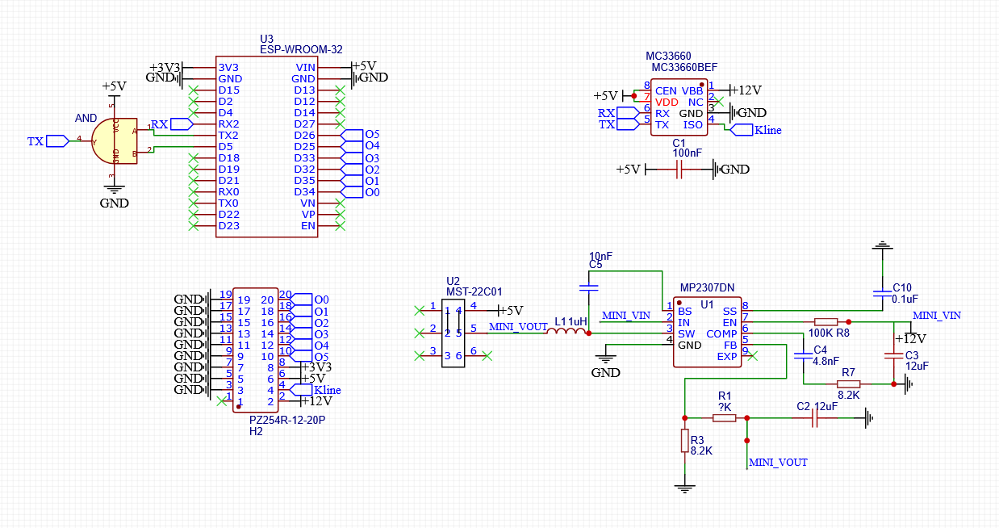
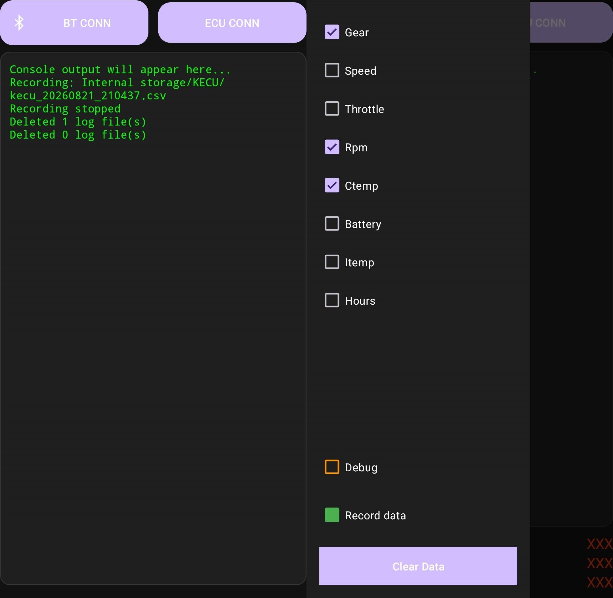

# KWP2000 Protocol Communicator for Kawasaki Ninja 400

This project involved designing and building a custom communication interface capable of retrieving diagnostic and real-time data from the ECU of a Kawasaki Ninja 400 motorcycle.

The device uses an ESP32 as the main controller and communicates with the motorcycle's ECU through the K-Line interface using the KWP2000 diagnostic protocol. The collected data can then be transmitted to a custom Android application for monitoring, logging, and debugging.

## Project Requirements

- Control and monitoring through a phone application
- ESP32 development board as the main controller
- Communication with the Kawasaki Ninja 400 ECU
- Real-time data acquisition
- Data logging and debugging capabilities

<br>

# Connecting to the ECU

## Starting the Communication

The Kawasaki Ninja 400 ECU communicates over the K-Line interface using the following serial configuration:

- **Baud rate:** 10,400 baud
- **Data bits:** 8
- **Parity:** None
- **Stop bits:** 1

Before normal communication can begin, the ECU requires a fast initialization sequence.

The initialization is performed by pulling the TX line LOW for 25 ms, followed by HIGH for 25 ms. After this sequence, normal serial communication can begin.

The start communication frame looks like this:

```text
81 11 F1 81 04
```

The message can be broken down as follows:

| Byte | Value | Description |
|------|-------|-------------|
| 0 | `0x81` | Address mode |
| 1 | `0x11` | Address of the receiver — ECU |
| 2 | `0xF1` | Address of the sender |
| 3 | `0x81` | Start communication request |
| 4 | `0x04` | Checksum |

In this case, the device identifies itself using address `0xF1` and sends a start communication request to the ECU at address `0x11`.

The expected response from the ECU is:

```text
80 F1 11 03 C1 EA 8F BF
```

When the message begins with `0x80`, the frame structure is slightly different:

| Byte | Value | Description |
|------|-------|-------------|
| 0 | `0x80` | Address mode |
| 1 | `0xF1` | Address of the receiver |
| 2 | `0x11` | Address of the sender — ECU |
| 3 | `0x03` | Number of data bytes that follow |
| 4 | `0xC1` | Communication request accepted |
| 5 | `0xEA` | Key byte 1 |
| 6 | `0x8F` | Key byte 2 |
| 7 | `0xBF` | Checksum |

Once this response is received, communication with the ECU has been successfully established.

## Starting the Diagnostic Session

After communication has been initialized, a diagnostic session can be started by sending the following frame:

```text
80 11 F1 02 10 80 14
```

The message structure is:

| Byte | Value | Description |
|------|-------|-------------|
| 0 | `0x80` | Address mode |
| 1 | `0x11` | Address of the receiver — ECU |
| 2 | `0xF1` | Address of the sender |
| 3 | `0x02` | Number of data bytes that follow |
| 4 | `0x10` | Start diagnostic session command |
| 5 | `0x80` | Manufacturer-specific byte |
| 6 | `0x14` | Checksum |

The ECU should respond with:

```text
80 F1 11 02 50 80 54
```

Again, the response can be broken down as follows:

| Byte | Value | Description |
|------|-------|-------------|
| 0 | `0x80` | Address mode |
| 1 | `0xF1` | Address of the receiver |
| 2 | `0x11` | Address of the sender — ECU |
| 3 | `0x02` | Number of data bytes that follow |
| 4 | `0x50` | Diagnostic request accepted |
| 5 | `0x80` | Manufacturer-specific byte |
| 6 | `0x54` | Checksum |

At this point, the ECU is operating within an active diagnostic session and can receive custom data requests.

## Requesting Custom Data

Once the communication and diagnostic session have been established, custom requests can be sent to retrieve data from the ECU.

Each parameter is accessed using a specific identifier, commonly referred to as a **PID**.

Many of these PIDs have already been discovered and documented by the motorcycle community. However, some ECU responses can vary depending on the motorcycle model and ECU version. For the Ninja 400, additional testing was required to determine the meaning and scaling of certain responses.

For this project, the following PIDs were used:

| Name | Request |
|------|---------|
| Throttle Position | `80 11 F1 02 21 04 A9` |
| Gear Position | `80 11 F1 02 21 0B B0` |
| RPM | `80 11 F1 02 21 09 AE` |
| Speed | `80 11 F1 02 21 0C B1` |
| Coolant Temperature | `80 11 F1 02 21 06 AB` |
| Battery Voltage | `80 11 F1 02 21 0A AF` |
| Intake Temperature | `80 11 F1 02 21 07 AC` |
| Engine Hours | `80 11 F1 02 21 44 E9` |

It is also important to note that the diagnostic session will automatically close if no requests are sent for a certain period of time.

To prevent the session from closing, the ESP32 periodically requests data from the ECU, keeping the diagnostic communication active.

<br>

# Hardware



The hardware design is relatively simple and is primarily responsible for interfacing the ESP32 with the motorcycle's K-Line diagnostic system.

## K-Line Interface

The MC33660 IC is used to convert the motorcycle's K-Line signal to a serial interface that can be used by the ESP32.

This IC provides the electrical interface required for reliable communication between the motorcycle ECU and the microcontroller.

## Main Controller

An ESP32 development board is used as the main controller of the device.

The ESP32 is responsible for:

- Performing the fast initialization sequence
- Communicating with the ECU
- Sending diagnostic requests
- Receiving and processing ECU responses
- Communicating with the Android application
- Managing additional input and output functionality

## Fast Initialization Circuit

An AND gate was added to the TX line so that the communication line can be actively pulled LOW during the fast initialization sequence.

This allows the ESP32 to perform the required 25 ms LOW / 25 ms HIGH initialization before switching to normal serial communication.

## Power Supply

The device is powered directly from the motorcycle's 12V electrical system.

An MP2307 buck converter, commonly used in Mini-360-style step-down converter modules, is used to reduce the motorcycle's battery voltage to 5V.

This allows the ESP32 and supporting electronics to be powered directly when the motorcycle is turned on.

## Expansion Connector

A 20-pin connector was included in the design to provide access to additional inputs and outputs.

These connections can be used to implement additional functions based on the information collected from the motorcycle.

<br>

# Control



A custom Android application was developed using the Android Studio development environment.

The application communicates with the ESP32 and provides an interface for monitoring and recording data retrieved from the motorcycle.

The application allows the user to:

- Monitor ECU data in real time
- View diagnostic parameters
- Record and log data
- Debug communication with the motorcycle
- Control and interact with the custom hardware

The mobile application provides a convenient interface for visualizing and working with the data collected from the motorcycle.

<br>

# Final Result

The completed project successfully demonstrated:

- Communication with the Kawasaki Ninja 400 ECU
- KWP2000 diagnostic communication over the K-Line interface
- Custom diagnostic request generation
- Real-time retrieval of ECU parameters
- ESP32-based embedded system development
- Custom K-Line interface hardware
- Direct integration with the motorcycle's 12V electrical system
- Android application development for monitoring and data logging

This project provided practical experience in embedded systems, automotive and motorcycle diagnostics, serial communication, protocol analysis, custom hardware design, and Android application development.