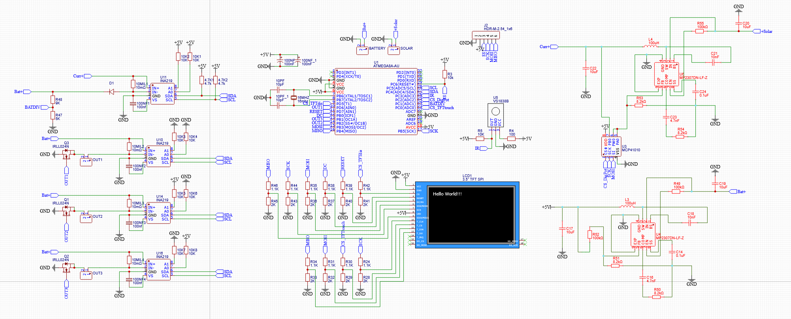
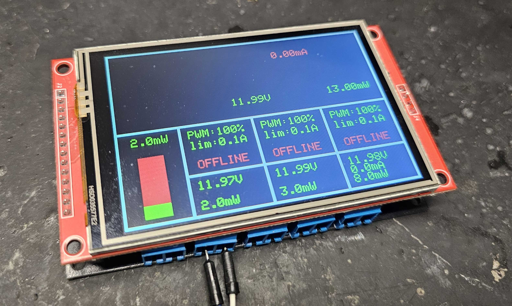

# Maximum Power Point Tracking (MPPT) Solar Controller

This project was an attempt to design and build a custom Maximum Power Point Tracking (MPPT) controller for a solar power system. The goal was to create a device capable of efficiently stepping down voltage from a solar panel while continuously tracking the operating point that delivers maximum power output.
The system was designed to supply connected loads, charge a 12V battery, and provide monitoring and control features through an integrated user interface.

# Project Requirements

- ATmega328P microcontroller as the main control unit
- Integrated TFT color display for system monitoring and user interaction
- Four independent voltage and current monitoring channels
- Support for 12V+ input power systems
- PWM-controllable output channels
- Software-controlled DC-DC step-down converter
- Battery charging capability
- MPPT power optimization functionality

 

# System Design

## Measurement and Monitoring

To measure system voltage and current, INA219 current and power monitoring ICs were selected. The devices communicate through the I²C interface, allowing multiple sensors to share the same communication bus while operating under different addresses.
This architecture enabled implementation of four independent monitoring channels while minimizing wiring complexity and microcontroller pin usage.

 

## Output Control

Output switching and PWM regulation were implemented using IRLL024N MOSFETs, selected for their current handling capability and compact footprint.
Each output channel supports software-controlled PWM adjustment, enabling flexible power delivery to connected loads.

 

## Display Interface

A TFT color display was integrated to provide system information and user interaction capabilities.
Since the display operates at 3.3V logic levels while the ATmega328P operates at 5V, resistor divider circuits were implemented as simple logic-level shifters to ensure signal compatibility.

 

## Power Supply Architecture

The control electronics power stage was based on circuitry commonly found in the Mini-360 buck converter, configured to generate a regulated 5V supply rail for system operation.

For MPPT operation, the design required:
- Real-time voltage and current measurement
- Dynamic control of a DC-DC converter operating point

To achieve software-adjustable converter control, an MCP41010 digital potentiometer was integrated into the feedback network of a second Mini-360-derived buck converter.
The intention was to dynamically modify converter behavior and continuously search for the solar panel operating point delivering maximum power output.
This design decision ultimately exposed a hardware limitation that prevented complete MPPT implementation and became one of the major lessons learned during development.

 

## Additional Features

As an alternative control method, an IR receiver module was integrated, enabling wireless switching and output control using a standard infrared remote controller.
After schematic completion, the design was converted into a custom PCB layout, manufactured externally, and assembled by hand.

---

# Software

Communication between peripherals and the ATmega328P was implemented using both I²C and SPI protocols.
I²C devices operated using individually assigned addresses, allowing multiple monitoring ICs to share a common bus. SPI peripherals were managed through dedicated chip-select signals.

The software interface provided:

- Individual output channel control
- PWM adjustment for each output
- Real-time voltage and current monitoring
- Overcurrent protection with automatic shutdown functionality
- User interaction through display menus and remote control integration

Protection features were implemented to improve system reliability and prevent damage under abnormal operating conditions.

---

# Development Challenges

One of the major challenges during development involved implementation of the touchscreen display interface.
Despite multiple attempts, touchscreen functionality could not be fully integrated into the final system. To maintain usability, the previously implemented IR receiver system was expanded to provide an alternative user input method.

A more significant issue emerged in the MPPT control circuitry.
The MCP41010 digital potentiometer was connected in a configuration where terminal voltages exceeded the device supply voltage limitations. This hardware design mistake prevented reliable operation of the dynamically adjustable feedback network.

As a result, full MPPT functionality could not be achieved, preventing implementation of continuous maximum power point optimization.

Although the intended feature set was not fully realized, the project provided valuable experience in:

- Power electronics design
- Embedded systems development
- Multi-protocol communication (SPI and I²C)
- PCB design and assembly
- Hardware validation and debugging
- Identifying design constraints during system integration

---

# Final Result

The completed system successfully demonstrated:

- Multi-channel voltage and current monitoring
- PWM-controlled output channels
- Custom PCB design and assembly
- Embedded firmware development
- Remote-controlled user interaction
- Power distribution and regulation architecture

While dynamic MPPT functionality was ultimately limited by a hardware design oversight, the project served as a valuable engineering learning experience and reinforced the importance of component limitations and early design validation.

# Final Product

